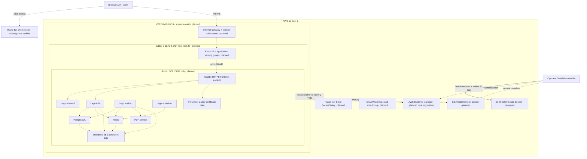

# M2 Communication and Deployment Status

Updated: 2026-10-11. Only the state bucket is verified deployed. Networking
is implemented and planned; host, application, and supporting modules remain
future work. Dashed links describe planned communication.

The exact pinned Compose dependencies and secret-retrieval identity will be
verified in their respective checkpoints. DNS is a lookup path. SSH, private
subnets, NAT, ALB, managed PostgreSQL/Redis, and a second host are deferred.
